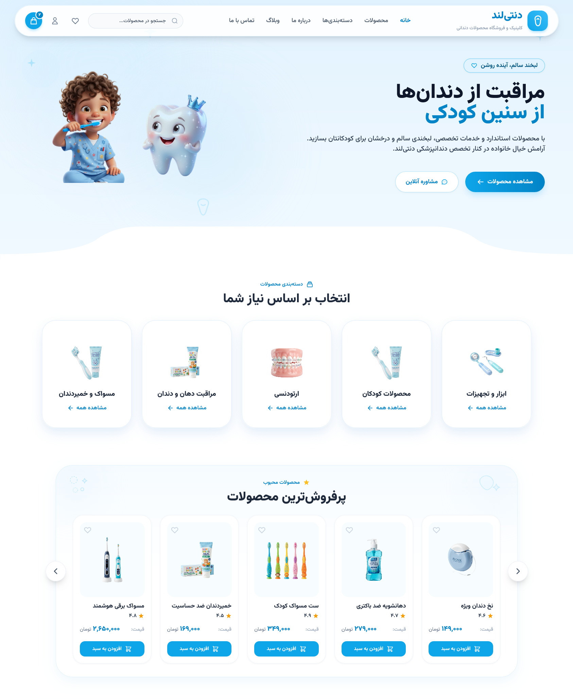

# 🦷 Dentiland | Pediatric & Family Dental Care

<div align="center">

### Modern E-Commerce Platform & Clinical Portal for Pediatric Oral Care

**Crafted with React 19, TypeScript, Vite, and Tailwind CSS v4**

[](https://react.dev/)
[](https://www.typescriptlang.org/)
[](https://vitejs.dev/)
[](https://tailwindcss.com/)
[](LICENSE)

[Preview](#-preview) • [Demo](#-demo) • [Key Features](#-key-features) • [Tech Stack](#-tech-stack) • [Project Structure](#-project-structure) • [Getting Started](#-getting-started)

</div>

---

## 👀 Preview

<div align="center">



<p><em>Dentiland — Website Preview</em></p>

</div>

---

## 🚀 Demo

Experience Dentiland and explore its e-commerce and clinical consultation features.

**[🌐 View Live Demo](YOUR_DEPLOYED_WEBSITE_URL)**

> Replace `YOUR_DEPLOYED_WEBSITE_URL` with the URL of your deployed website.

---

## 📖 About The Project

**Dentiland** is a modern, responsive e-commerce web application and clinical hub dedicated to children's oral health, dental hygiene, and orthodontics.

Engineered with a child-friendly yet medically credible design language, Dentiland combines soft glassmorphism, soothing sky-blue gradients, and fluid micro-interactions to create a welcoming shopping and consultation experience for both parents and kids.

---

## ✨ Key Features

- 📱 **Floating Pill Island Navigation**
  - **Mobile:** Minimalist floating bar featuring hamburger drawer trigger, brand identity, quick search, and shopping bag with dynamic badge count.
  - **Desktop:** 3D tooth brand logo, primary navigation links, real-time live search dropdown, wishlist toggle, online consultation trigger, and shopping cart drawer opener.

- 🎨 **Hero Section with Seamless Curved Boundary**
  - High-resolution pediatric dentistry illustrations and 3D character assets.
  - Custom responsive SVG bottom curve transition that stays sharp across screen sizes without visual artifacts.

- 🛍️ **Popular Product Categories**
  - Five dedicated categories: Manual & Electric Toothbrushes, Fluoride Toothpastes, Dental Floss & Picks, Orthodontic Care, and Oral Hygiene Accessories.
  - Horizontal snap-scroll on touch devices and a five-column grid on desktop.

- ⭐ **Best Sellers Carousel & Product Quick View**
  - Interactive product slider with next/previous controls and stock indicators.
  - Product detail modal featuring image galleries, specifications, stock status, star ratings, and one-click purchase.

- 🛡️ **Why Dentiland? (Trust & Value Proposition)**
  - Minimalist Lucide iconography highlighting product authenticity, hygienic delivery, specialized pediatric consultation, and a seven-day return policy.

- 🛒 **Slide-Over Shopping Cart Drawer**
  - Real-time cart state management.
  - Quantity increment/decrement and item removal.
  - Promotional discount breakdowns and dynamic checkout total calculation.

- ❤️ **Wishlist Drawer / Modal**
  - Quick-toggle favorites system.
  - Move saved products directly to the shopping cart.

- 👨‍⚕️ **Online Dental Consultation Modal**
  - Interactive appointment booking form for parents seeking specialist dental advice.

- 📰 **Educational Dental Articles & Blog**
  - Curated oral hygiene articles for parents.
  - Full-reading modal dialogs for educational content.

- 🌍 **RTL & Typography Excellence**
  - Right-to-left layout support powered by Google's Vazirmatn font for Persian and Arabic typography.

---

## 🛠️ Tech Stack

| Technology | Purpose |
|---|---|
| **React 19** | Modern UI component hierarchy and reactive state management |
| **TypeScript** | Type safety, maintainability, and clean code architecture |
| **Vite 6** | Fast development server and optimized production builds |
| **Tailwind CSS v4** | Modern CSS-first utility styling and responsive layouts |
| **Lucide React** | Consistent, lightweight SVG icon system |
| **Vazirmatn** | High-legibility typography optimized for RTL text |

---

## 📁 Project Structure

```text
dentiland/
├── public/
│   ├── assets/                 # Product images, category icons & banners
│   └── dentiland-source.zip    # Pre-packaged source archive
├── src/
│   ├── components/
│   │   ├── ArticleModal.tsx       # Full educational article reading dialog
│   │   ├── Articles.tsx           # Blog and dental tips showcase section
│   │   ├── BestSellers.tsx        # Best-selling products slider and grid
│   │   ├── CartDrawer.tsx         # Slide-over shopping cart with checkout summary
│   │   ├── Categories.tsx         # Product category quick navigation
│   │   ├── ConsultationModal.tsx  # Appointment booking and consultation form
│   │   ├── Footer.tsx             # Clinical credentials, links & contact info
│   │   ├── Header.tsx             # Floating pill navigation (mobile & desktop)
│   │   ├── Hero.tsx               # Hero showcase with custom curved SVG transition
│   │   ├── ProductDetailModal.tsx # Product specification and gallery modal
│   │   ├── Reviews.tsx            # Patient and parent testimonials
│   │   ├── WhyDentiland.tsx       # Brand advantages with minimalist iconography
│   │   └── WishlistModal.tsx      # Saved items management modal
│   ├── data/
│   │   └── dentilandData.ts       # Products, categories, blog posts & review mock data
│   ├── App.tsx                    # Core application layout & unified state handler
│   ├── index.css                  # Global styles, Tailwind imports, and font settings
│   └── main.tsx                   # React root entry point
├── index.html                     # HTML5 template with SEO meta tags & RTL attributes
├── package.json                   # Project scripts and dependencies
├── tsconfig.json                  # TypeScript compiler configuration
└── vite.config.ts                 # Vite bundler configuration
```

---

## 🚀 Getting Started

### Prerequisites

Ensure you have the following installed on your machine:

- **Node.js:** `v18.0.0` or higher
- **npm**, **yarn**, or **pnpm**

### Local Setup

**1. Clone the repository**

```bash
git clone https://github.com/your-username/dentiland.git
cd dentiland
```

**2. Install project dependencies**

```bash
npm install
```

**3. Start the local development server**

```bash
npm run dev
```

Open the local URL displayed in your terminal to view the application. Vite commonly uses `http://localhost:5173/` by default, unless configured otherwise.

**4. Build for production**

```bash
npm run build
```

The production-ready assets will be generated in the `dist/` directory.

**5. Preview the production build locally**

```bash
npm run preview
```

Open the local URL displayed in the terminal to inspect the production build.

---

## 🎨 Design System & Palette

- **Primary Clinical Blue:** `#006591` / `#0ea5e9`
- **Soft Backgrounds:** `#faf8ff` / `#e0f2fe`
- **Surface Elevation:** `bg-white/95 backdrop-blur-xl`
- **Typography:** Vazirmatn (font weights: 300 to 900)
- **Border Radius Philosophy:** Organic rounded elements (`rounded-2xl`, `rounded-3xl`, `rounded-full`)

---

## 📄 License

Distributed under the **Apache-2.0 License**. See [LICENSE](LICENSE) for more details.

---

<div align="center">

**Made with care for healthier, happier smiles.**

</div>
